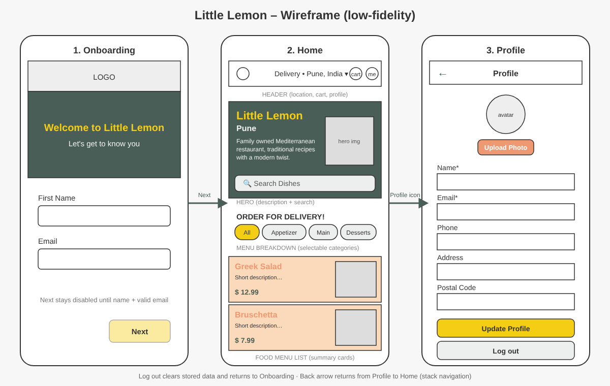

# coursera-meta-react-native-specialization-capstone-project
Little Lemon Food Delivery App with React Native (Expo) for Coursera - Meta React Native Specialization - Capstone Project

## Wireframe
The screens are based on this wireframe: [docs/wireframe.png](docs/wireframe.png)



## Flow
1. **Onboarding** (first launch only): enter first name + valid email. The **Next** button stays disabled until both are valid.
2. **Home**: header (location, cart, profile), hero (restaurant description + search bar), menu breakdown (selectable categories), food menu list.
3. **Profile**: pre-filled from the saved data, edits persist in SQLite across restarts, **Log out** clears all data and returns to Onboarding. A back arrow returns to Home (stack navigation).

## Setup
```
npm install
cp .env.example .env   # add your Google Maps API key
npx expo start
```
